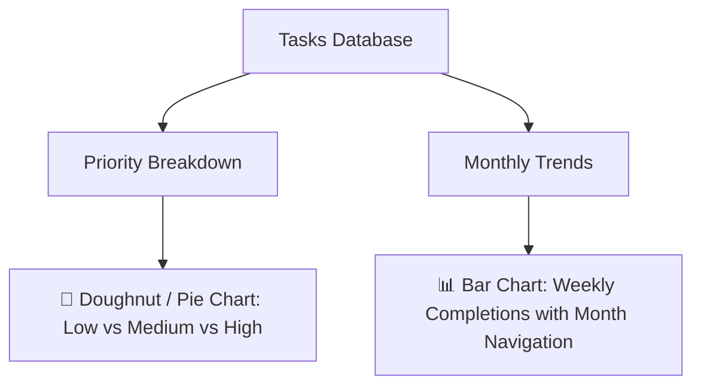

<!-- ======================================================================= -->
<!-- HEADER: ANIMATED WAVING GRADIENT BANNER -->
<!-- ======================================================================= -->
<div align="center">
  
</div>

<!-- ======================================================================= -->
<!-- TYPING SVG: DYNAMIC ROTATING ANIMATED PUNCHLINES -->
<!-- ======================================================================= -->
<div align="center">
  <a href="https://github.com/qwerty274/taskmanager-nsoc2">
    
  </a>
</div>

<br />

<!-- ======================================================================= -->
<!-- SHIELDS BADGES -->
<!-- ======================================================================= -->
<div align="center">

[](https://app.netlify.com/start/deploy?repository=https://github.com/qwerty274/taskmanager-nsoc2)
[](LICENSE)
[](CONTRIBUTING.md)
[](https://developer.mozilla.org/en-US/docs/Web/JavaScript)
[](https://www.chartjs.org/)

</div>

<br />

<!-- ======================================================================= -->
<!-- QUICK NAVIGATION -->
<!-- ======================================================================= -->
<div align="center">

[✨ Key Features](#-key-features) •
[🎬 Live Showcase](#-live-interactive-showcase) •
[📊 Analytics Dashboard](#-analytics-dashboard) •
[🛠️ Tech Stack](#%EF%B8%8F-tech-stack) •
[🚀 Quick Start](#-quick-start) •
[📁 Project Structure](#-project-structure) •
[🤝 Contributing](#-contributing) •
[🗺️ Roadmap](#%EF%B8%8F-roadmap)

</div>

<br />

---

### 🌟 Overview

**Task Manager & Productivity Dashboard** is a fast, responsive, and distraction-free web productivity platform built using pure **Vanilla HTML5, modern CSS3, and ES6+ JavaScript**, enhanced with interactive visual analytics by **[Chart.js](https://www.chartjs.org/)**.

Whether tracking daily sprint objectives, prioritizing critical deadlines, reviewing monthly completion velocity, or keeping personal goals organized, Task Manager provides a seamless experience with zero runtime dependencies and 100% client-side privacy.

---

## 🎬 Live Interactive Showcase

<div align="center">
  
  <p><em>▲ Real-time demonstration: Creating tasks with priorities, marking completion, inline double-click editing, history toggling, and rendering interactive Chart.js analytics.</em></p>
</div>

---

## ✨ Key Features

<table>
  <tr>
    <td width="50%">
      <h3>⚡ Smart Task Management</h3>
      <p>Create tasks instantly with custom due dates and color-coded priority indicators (<code>Low</code>, <code>Medium</code>, <code>High</code>) for rapid visual triage.</p>
    </td>
    <td width="50%">
      <h3>✏️ Inline Double-Click Editing</h3>
      <p>Double-click directly on any task title to edit it inline on the fly without interrupting your workflow or dealing with bulky modals.</p>
    </td>
  </tr>
  <tr>
    <td width="50%">
      <h3>🚨 Automated Overdue Detection</h3>
      <p>Active tasks that cross their due dates are highlighted with clear visual overdue badges and styling so nothing slips through the cracks.</p>
    </td>
    <td width="50%">
      <h3>📅 Month-wise Task Grouping</h3>
      <p>When viewing all tasks, items are automatically collated by their respective calendar month, making mid-to-long term scheduling effortless.</p>
    </td>
  </tr>
  <tr>
    <td width="50%">
      <h3>⏳ History Mode & Multi-Filter</h3>
      <p>One-click toggle between active view and comprehensive history. Filter tasks dynamically across <code>All</code>, <code>Active</code>, <code>Done</code>, and <code>Overdue</code>.</p>
    </td>
    <td width="50%">
      <h3>💾 Zero-Setup Local Persistence</h3>
      <p>All state is automatically synchronized with the browser's <code>localStorage</code> API. No database setup, no account creation, and zero latency.</p>
    </td>
  </tr>
  <tr>
    <td width="50%">
      <h3>🔍 Real-Time Task Search</h3>
      <p>Filter active or historical tasks by keyword with instant live matching and one-click clear button.</p>
    </td>
    <td width="50%">
      <h3>🔀 Multi-Criteria Sorting</h3>
      <p>Sort tasks dynamically by due date (earliest or latest), priority level (high to low or low to high), or alphabetically.</p>
    </td>
  </tr>
  <tr>
    <td width="50%">
      <h3>📦 Task Export &amp; Backup</h3>
      <p>Download your complete task list anytime in <code>JSON</code> or RFC 4180-compliant <code>CSV</code> format for easy data portability and offline backups.</p>
    </td>
    <td width="50%">
      <h3>📥 Task Import &amp; Restore</h3>
      <p>Safely restore tasks from JSON or CSV files with strict schema validation, drag-and-drop file picker, and flexible <code>Merge</code> (deduplicated) or <code>Replace</code> modes.</p>
    </td>
  </tr>
</table>

---

## 📊 Analytics Dashboard

Gain instant visual insight into your workload and completion velocity with dynamic, responsive **Chart.js** data visualizations:



- 🍩 **Priority Breakdown Chart**: Visualizes task distribution across Low, Medium, and High priorities, complete with a custom legend.
- 📈 **Monthly Completion Trends**: Interactive bar chart plotting completed tasks week-by-week. Includes intuitive `◀` and `▶` month-by-month navigation buttons to track your productivity journey over time.

---

## 🛠️ Tech Stack

<div align="center">

| Technology | Role | Highlights |
| :--- | :--- | :--- |
|  | **Structure** | Semantic HTML5, accessible form controls, ARIA attributes |
|  | **Styling** | Vanilla CSS, CSS Variables (`:root`), Flexbox, Grid, Glassmorphism, Micro-animations |
|  | **Logic & State** | Pure ES6+, DOM manipulation, Event delegation, `localStorage` API |
|  | **Data Visualization** | Priority doughnut charts & month-by-month completion trend bar charts |

</div>

<details>
<summary><b>🔍 Why Pure Vanilla Web Technologies? (Click to Expand)</b></summary>
<br />

- ⚡ **Zero Build Step**: No `npm install`, no Webpack/Vite bundlers, no waiting for compiles.
- 🪶 **Ultra Lightweight**: Sub-millisecond load times with negligible memory footprint.
- 🔒 **Privacy-First**: No external tracking or remote server calls for task data.
- 📱 **Universally Compatible**: Runs identically across any modern desktop, tablet, or mobile browser.

</details>

---

## 📁 Project Structure

```bash
taskmanager/
├── 📄 index.html                # Main semantic application markup & canvas containers
├── 🎨 style.css                 # Design system, CSS variables, glassmorphism & dark theme
├── ⚡ script.js                 # Core application logic, event listeners & Chart.js engine
├── ⚙️ netlify.toml              # Netlify static deployment & security headers
├── 📖 README.md                 # Project documentation & animated showcase
├── 🤝 CONTRIBUTING.md           # Contribution guidelines & branching workflow
├── 📜 CODE_OF_CONDUCT.md        # Community participation standards
├── ⚖️ LICENSE                   # MIT Open Source License
├── 🖼️ assets/                   # Visual demo assets & graphics
│   └── taskmanager-demo.gif     # Recorded application interaction animation
└── 📂 .github/                  # GitHub configuration & templates
    ├── PULL_REQUEST_TEMPLATE.md
    └── ISSUE_TEMPLATE/
        ├── bug_report.md
        └── feature_request.md
```

---

## 🚀 Quick Start

You can run this project locally in seconds without installing Node.js or any package manager!

### Option 1: Direct Browser Launch (Fastest)

1. **Clone the repository:**
   ```bash
   git clone https://github.com/qwerty274/taskmanager-nsoc2.git
   cd taskmanager-nsoc2
   ```
2. **Open `index.html`:**
   - Double-click `index.html` in your file explorer, or
   - Drag and drop `index.html` directly into Chrome, Firefox, Edge, or Safari.

### Option 2: VS Code Live Server

1. Open the project folder in **Visual Studio Code**:
   ```bash
   code .
   ```
2. Install the **Live Server** extension (if not already installed).
3. Right-click [`index.html`](index.html) and select **"Open with Live Server"** or click **"Go Live"** in the status bar.

### Option 3: Local HTTP Server

```bash
# Using Python 3:
python -m http.server 8080

# Or using Node npx:
npx serve .
```
Navigate to `http://localhost:8080` in your web browser.

### 📅 Overdue Date Regression Checks

1. **Yesterday's due date:** Add an active task due yesterday. Confirm that it receives an **Overdue** badge and appears under the **Overdue** history filter.
2. **Today's due date:** Add an active task due today. Confirm that it does not receive an **Overdue** badge.
3. **No due date:** Using browser developer tools, set a stored task's `dueDate` to an empty string and reload. Confirm that it never receives an **Overdue** badge.
4. **Date change while open:** Keep a task due today open past local midnight, or temporarily advance the system date by one day. Return to the tab and confirm that the badge appears within 60 seconds without reloading the page.

### 💾 Stored Data Regression Checks

Use browser developer tools to run each command, then reload the page:

1. **Malformed JSON:** Run `localStorage.setItem('tasks', '{invalid')`. Confirm that the app loads without tasks or browser errors.
2. **Unexpected storage value:** Run `localStorage.setItem('tasks', '{"text":"Not an array"}')`. Confirm that the value is ignored.
3. **Missing required fields:** Run `localStorage.setItem('tasks', '[{"text":"Incomplete task"}]')`. Confirm that the incomplete record is not rendered.
4. **Invalid field types:** Run `localStorage.setItem('tasks', '[{"text":"Invalid task","dueDate":null,"priority":"medium","completed":"false","completedAt":null}]')`. Confirm that the invalid record is not rendered.
5. **Mixed valid and invalid records:** Run `localStorage.setItem('tasks', JSON.stringify([{ text: 'Keep this task', dueDate: '', priority: 'medium', completed: false, completedAt: null }, { text: 'Discard this task', dueDate: '', priority: 'medium', completed: 'false', completedAt: null }]))`. Confirm that only **Keep this task** is rendered and remains usable.

### 🔍 Search & Sorting Regression Checks

1. **Live Search Filtering:** Type a keyword into the search bar. Confirm that only matching tasks appear, and the clear (`×`) button is visible.
2. **Empty Search Result:** Search for a non-existent task name. Confirm that the custom empty state message (`🔍 No tasks found matching "..."`) is displayed.
3. **One-Click Clear:** Click the `×` button. Confirm that the search input is cleared, the clear button hides, and the full task list is restored.
4. **Sorting Verification:** Select each sort option (`Due Date`, `Priority`, `Title A-Z/Z-A`) and confirm that items re-order instantly without altering task state or persistence.
5. **Combined Filter & Sort:** Apply a filter (e.g., `Done` or `Active`) or switch to History mode and confirm that search and sort accurately scope to that view.

### 📦 Backup, Export & Import Regression Checks

1. **JSON Export:** Click **Backup & Restore** -> click **Export JSON**. Confirm that `tasks-backup-YYYY-MM-DD.json` downloads and contains a valid array of tasks.
2. **CSV Export:** Click **Export CSV**. Confirm that `tasks-backup-YYYY-MM-DD.csv` downloads with proper headers and escaping for commas, quotes, and newlines.
3. **Valid Import (Merge Mode):** Choose a JSON or CSV backup with new tasks. With **Merge** selected, click **Import Tasks**. Confirm that new tasks are added to your existing list and exact duplicates are skipped.
4. **Valid Import (Replace Mode):** Select **Replace** mode and import a backup file. Confirm that existing tasks are cleared and replaced by the imported tasks.
5. **Malformed File Handling:** Attempt to import an invalid JSON or corrupted CSV file. Confirm that the app displays a clear user-facing error message and does **not** alter or corrupt existing tasks.
6. **Partially Invalid Batch:** Attempt to import a file where one task is missing the `text` field or has an invalid priority. Confirm the entire batch is rejected with an explanatory message, leaving existing tasks intact.
7. **Automated Unit Tests:** Run the automated test suite using Node.js built-in test runner:
   ```bash
   node --test test-export-import.js
   ```

---

## 🗺️ Roadmap

Exciting features planned for future releases:

- [ ] 🔄 **Drag-and-Drop Reordering**: Interactive task sequencing using HTML5 Drag and Drop API.
- [ ] 🏷️ **Custom Tags & Categories**: Multi-label tagging with custom color badges.
- [x] 📥 **Data Import / Export**: One-click JSON / CSV backup and restore with strict schema validation and merge/replace strategies.
- [ ] 📋 **Subtasks & Nested Checklists**: Granular sub-item progress tracking.
- [x] 🔍 **Task Search & Multi-Criteria Sorting**: Live search by keyword and dynamic sorting by date, priority, or title.
- [x] ☀️ **Dark / Light Theme Switcher**: Dynamic theme toggle with persistent preference.
- [ ] 📱 **Progressive Web App (PWA)**: Offline service workers and mobile app installability.

---

## 🤝 Contributing

Contributions make open-source projects thrive! Whether reporting a bug, proposing a new feature, or submitting a pull request, your contributions are warmly welcomed.

1. **Fork** the repository on GitHub.
2. **Clone** your fork locally:
   ```bash
   git clone https://github.com/YOUR_USERNAME/taskmanager-nsoc2.git
   ```
3. **Create a descriptive feature branch**:
   ```bash
   git checkout -b feature/drag-and-drop-tasks
   ```
4. **Commit** your changes following [Conventional Commits](https://www.conventionalcommits.org/):
   ```bash
   git commit -m "feat: add drag-and-drop task reordering"
   ```
5. **Push** to your branch:
   ```bash
   git push origin feature/drag-and-drop-tasks
   ```
6. **Open a Pull Request** via the GitHub web interface.

> Please read our **[CONTRIBUTING.md](CONTRIBUTING.md)** and **[CODE_OF_CONDUCT.md](CODE_OF_CONDUCT.md)** before contributing.

---

## 📄 License

Distributed under the **MIT License**. See [`LICENSE`](LICENSE) for full details.

---

<div align="center">
  <p>Developed with ❤️ for productive minds everywhere • Give this repository a ⭐️ if you find it helpful!</p>
  
</div>
