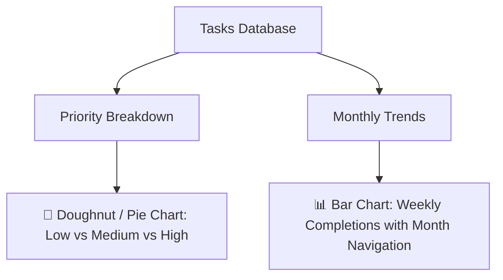

<!-- ======================================================================= -->
<!-- HEADER: ANIMATED WAVING GRADIENT BANNER -->
<!-- ======================================================================= -->
<div align="center">
  
</div>

<!-- ======================================================================= -->
<!-- TYPING SVG: DYNAMIC ROTATING ANIMATED PUNCHLINES -->
<!-- ======================================================================= -->
<div align="center">
  <a href="https://github.com/qwerty274/taskmanager-nsoc2">
    
  </a>
</div>

<br />

<!-- ======================================================================= -->
<!-- SHIELDS BADGES -->
<!-- ======================================================================= -->
<div align="center">

[](https://app.netlify.com/start/deploy?repository=https://github.com/qwerty274/taskmanager-nsoc2)
[](LICENSE)
[](CONTRIBUTING.md)
[](https://developer.mozilla.org/en-US/docs/Web/JavaScript)
[](https://www.chartjs.org/)

</div>

<br />

<!-- ======================================================================= -->
<!-- QUICK NAVIGATION -->
<!-- ======================================================================= -->
<div align="center">

[✨ Key Features](#-key-features) •
[🎬 Live Showcase](#-live-interactive-showcase) •
[📊 Analytics Dashboard](#-analytics-dashboard) •
[🛠️ Tech Stack](#%EF%B8%8F-tech-stack) •
[🚀 Quick Start](#-quick-start) •
[📁 Project Structure](#-project-structure) •
[🤝 Contributing](#-contributing) •
[🗺️ Roadmap](#%EF%B8%8F-roadmap)

</div>

<br />

---

### 🌟 Overview

**Task Manager & Productivity Dashboard** is a fast, responsive, and distraction-free web productivity platform built using **React 18, Vite 6, CSS, and ES6+ JavaScript**, enhanced with interactive visual analytics by **[Chart.js](https://www.chartjs.org/)**.

Whether tracking daily sprint objectives, prioritizing critical deadlines, reviewing monthly completion velocity, or keeping personal goals organized, Task Manager provides a seamless experience with tasks stored locally in the browser rather than on an application server.

---

## 🎬 Live Interactive Showcase

<div align="center">
  
  <p><em>▲ Real-time demonstration: Creating tasks with priorities, marking completion, inline double-click editing, history toggling, and rendering interactive Chart.js analytics.</em></p>
</div>

---

## ✨ Key Features

<table>
  <tr>
    <td width="50%">
      <h3>⚡ Smart Task Management</h3>
      <p>Create tasks instantly with custom due dates and color-coded priority indicators (<code>Low</code>, <code>Medium</code>, <code>High</code>) for rapid visual triage.</p>
    </td>
    <td width="50%">
      <h3>✏️ Inline Double-Click Editing</h3>
      <p>Double-click directly on any task title to edit it inline on the fly without interrupting your workflow or dealing with bulky modals.</p>
    </td>
  </tr>
  <tr>
    <td width="50%">
      <h3>🚨 Automated Overdue Detection</h3>
      <p>Active tasks that cross their due dates are highlighted with clear visual overdue badges and styling so nothing slips through the cracks.</p>
    </td>
    <td width="50%">
      <h3>📅 Month-wise Task Grouping</h3>
      <p>When viewing all tasks, items are automatically collated by their respective calendar month, making mid-to-long term scheduling effortless.</p>
    </td>
  </tr>
  <tr>
    <td width="50%">
      <h3>⏳ History Mode & Multi-Filter</h3>
      <p>One-click toggle between active view and comprehensive history. Filter tasks dynamically across <code>All</code>, <code>Active</code>, <code>Done</code>, and <code>Overdue</code>.</p>
    </td>
    <td width="50%">
      <h3>💾 Zero-Setup Local Persistence</h3>
      <p>All state is automatically synchronized with the browser's <code>localStorage</code> API. No database setup, no account creation, and zero latency.</p>
    </td>
  </tr>
  <tr>
    <td width="50%">
      <h3>🔍 Real-Time Task Search</h3>
      <p>Filter active or historical tasks by keyword with instant live matching and one-click clear button.</p>
    </td>
    <td width="50%">
      <h3>🔀 Multi-Criteria Sorting</h3>
      <p>Sort tasks dynamically by due date (earliest or latest), priority level (high to low or low to high), or alphabetically.</p>
    </td>
  </tr>
</table>

---

## 📊 Analytics Dashboard

Gain instant visual insight into your workload and completion velocity with dynamic, responsive **Chart.js** data visualizations:



- 🍩 **Priority Breakdown Chart**: Visualizes task distribution across Low, Medium, and High priorities, complete with a custom legend.
- 📈 **Monthly Completion Trends**: Interactive bar chart plotting completed tasks week-by-week. Includes intuitive `◀` and `▶` month-by-month navigation buttons to track your productivity journey over time.

---

## 🛠️ Tech Stack

<div align="center">

| Technology | Role | Highlights |
| :--- | :--- | :--- |
|  | **Structure** | Semantic HTML5, accessible form controls, ARIA attributes |
|  | **Styling** | Vanilla CSS, CSS Variables (`:root`), Flexbox, Grid, Glassmorphism, Micro-animations |
|  | **Logic & State** | React components and hooks, ES6+ utilities, `localStorage` API |
|  | **Data Visualization** | Priority doughnut charts & month-by-month completion trend bar charts |

</div>

### Runtime and privacy

React renders the UI; Vite serves it during development and produces `dist/` for hosting.
No database or application account is required. Tasks, theme, activity days and points are
saved in this browser's `localStorage`. Clearing site data removes them; other browsers,
profiles and devices do not automatically share them. Task backups do not include theme,
activity history or the points ledger. Do not use the sample storage-reset commands below
on your only copy of important tasks.

## 📁 Project Structure

```text
index.html                 # Vite entry; loads src/main.jsx
vite.config.js             # React plugin; development port 8080
src/
  main.jsx                 # Mounts the React application and imports index.css
  App.jsx                  # Task state, filters, history, backups and completion wiring
  index.css                # Shared styling, responsive layout and focus styles
  sw.js                    # Service worker source, bundled into dist/sw.js
  registerSW.js            # Registers the worker and reports waiting updates
  sw/                      # Pure service worker helpers, covered by test-sw-logic.js
  components/              # Forms, task controls, filters, charts, backup dialog and undo
  hooks/                   # Local storage, theme and timed undo behavior
  utils/                   # Task dates/sorting, backup validation, streaks and points
public/                    # Web app manifest and icons
vite-sw-plugin.js          # Builds dist/sw.js with a version hash and precache list
netlify.toml               # Netlify build and cache header rules
package.json               # dev, build, preview and test commands
package-lock.json          # Reproducible npm dependency versions
CONTRIBUTING.md            # Contribution workflow and manual verification
```

## 🚀 Quick Start (React + Vite)

Use Node.js 20.19+ or 22.12+ and npm. From a cloned checkout:

```bash
npm ci
npm run dev
```

Open the local URL printed by Vite (normally `http://localhost:8080`; another port
may be chosen if it is busy). Opening `index.html` directly or using Live Server
will not compile JSX or resolve package imports.

```bash
npm test                 # Configured backup, date, undo and service worker regression suites
npm run build            # Production files in dist/
npm run preview          # Preview that build; use the printed local URL
```

There is no configured lint script. `npm test` does not run every standalone
`test-*.js` file; in particular it does not include the streak test file.

### Search, filters and sorting

Search matches task titles case-insensitively within the current filter. Clear search
with the labelled × button. Statistics cards select All, Active, Completed or Overdue;
History also exposes filter buttons and completion charts. Search and sorting continue
to apply when changing a filter. Overdue means an unfinished task due before the local
today; missing dates and tasks due today are not overdue.

Choose one sort mode: earliest/latest due date, high/low priority, or title A–Z/Z–A.
Missing dates stay last for date sorts. Sorting changes the displayed order, not saved
task contents. All groups cards by due-date month, so it is not one globally sorted list
across months. “Multi-criteria” refers to these available sort choices, not a UI for
stacking several sort keys.

### Export and import

Open **Backup & Restore Tasks** from the header. Export all tasks as JSON or CSV;
search and filters do not limit the export. The file name includes the local date.
Select or drop a JSON/CSV backup, wait for validation, then press **Import Tasks**.
Invalid files save nothing. **Merge** keeps current tasks and skips content duplicates;
**Replace** clears the current list and uses the imported tasks. Export a backup before
replacing. Importing tasks does not restore streaks or points.

### Daily streaks and points

Completing a task records activity on the local calendar day and awards 10 points once
per task id. Reopening and completing that same task does not award another 10 points;
reopening does not subtract existing points. A streak stays alive if the latest activity
was today or yesterday. Milestone bonuses are 20 points at 3 days, 50 at 7 days, and 200
at 30 days, each awarded once. Current streak, best streak and balance appear below the
statistics. Importing already-completed tasks does not count as a new completion.

### Keyboard controls

| Key | What it does |
| :--- | :--- |
| `N` | Jump to the new task field |
| `/` | Jump to search |
| `?` | Open the shortcuts list (also the **Shortcuts** button in the header on wider screens) |
| `Esc` | Close the open dialog, or cancel a task edit |
| `Ctrl + D` | Clear the text field you are typing in (`Cmd + D` on a Mac) |
| `Ctrl + Z` | Undo a delete while the undo message is up (`Cmd + Z` on a Mac) |

The single keys are ignored while you type in a field or select box and while a dialog is
open, and anything held with Ctrl, Cmd or Alt is left to the browser. Ctrl + D is the one
exception, and only inside a text field: anywhere else it still bookmarks the page.

Use Tab/Shift+Tab to reach labelled fields, filter buttons and each task's **Edit**,
**Mark as done/active**, and **Delete** controls. Native buttons support Enter/Space.
Use Edit instead of double-clicking a title: Enter saves, Escape cancels, and leaving
the edit field saves a nonblank change. Delete exposes a temporary Undo action; hovering
or focusing the undo toast pauses its timer. The backup dialog supports Escape to close;
its file drop area supports Enter/Space, and import modes are native radio controls.

### Install and offline use

The production build can be installed as an app and keeps working offline. The service
worker only runs in production builds on HTTPS or localhost, so use the deployed site or
`npm run build` with `npm run preview`. `npm run dev` does not register it.

**Install:** in Chrome or Edge on desktop, use the install icon in the address bar or the
browser menu. In Chrome on Android, open the menu and choose **Add to Home screen** or
**Install app**. In Safari on iPhone or iPad, use **Share**, then **Add to Home Screen**.

**Offline:** the first online visit caches the app. After that it opens without a network
and tasks keep saving to `localStorage` as usual. The Google font only shows offline if it
was cached on an earlier visit, otherwise the browser uses a system font.

**Updates:** a new deploy downloads in the background, then a **New version available**
prompt appears. **Reload** switches to it right away. **Later** hides the prompt for that
version only: a newer version asks again, and the skipped one starts by itself once every
tab and window of the app has been closed. On phones the prompt sits at the top of the
page, above the app, so it stays clear of the task buttons and scrolls away with the page.

**Troubleshooting:**

- **No install option:** check that you are on HTTPS or localhost, not in a private window,
  and that the app is not already installed. Chrome DevTools lists what is blocking it
  under Application > Manifest.
- **Stuck on an old version:** close every tab and window of the app and open it again. As
  a last resort, unregister the worker in DevTools under Application > Service workers and
  reload. This does not touch your tasks.
- **Blank page while offline:** the app has to be opened once while online first.
- **Clearing site data** also deletes your tasks, so export a backup before doing it.
- **Hosting outside Netlify:** `netlify.toml` sends `Cache-Control: no-cache` for `sw.js`
  and `manifest.webmanifest`. Send the same header on other hosts so new versions show up
  quickly.

### 📅 Overdue Date Regression Checks

1. **Yesterday's due date:** Add an active task due yesterday. Confirm that it receives an **Overdue** badge and appears under the **Overdue** history filter.
2. **Today's due date:** Add an active task due today. Confirm that it does not receive an **Overdue** badge.
3. **No due date:** Using browser developer tools, set a stored task's `dueDate` to an empty string and reload. Confirm that it never receives an **Overdue** badge.
4. **Date change while open:** Keep a task due today open past local midnight, or temporarily advance the system date by one day. Return to the tab and confirm that the badge appears within 60 seconds without reloading the page.

### 💾 Stored Data Regression Checks

Use browser developer tools to run each command, then reload the page:

1. **Malformed JSON:** Run `localStorage.setItem('tasks', '{invalid')`. Confirm that the app loads without tasks or browser errors.
2. **Unexpected storage value:** Run `localStorage.setItem('tasks', '{"text":"Not an array"}')`. Confirm that the value is ignored.
3. **Missing required fields:** Run `localStorage.setItem('tasks', '[{"text":"Incomplete task"}]')`. Confirm that the incomplete record is not rendered.
4. **Invalid field types:** Run `localStorage.setItem('tasks', '[{"text":"Invalid task","dueDate":null,"priority":"medium","completed":"false","completedAt":null}]')`. Confirm that the invalid record is not rendered.
5. **Mixed valid and invalid records:** Run `localStorage.setItem('tasks', JSON.stringify([{ text: 'Keep this task', dueDate: '', priority: 'medium', completed: false, completedAt: null }, { text: 'Discard this task', dueDate: '', priority: 'medium', completed: 'false', completedAt: null }]))`. Confirm that only **Keep this task** is rendered and remains usable.

### 🔍 Search & Sorting Regression Checks

1. **Live Search Filtering:** Type a keyword into the search bar. Confirm that only matching tasks appear, and the clear (`×`) button is visible.
2. **Empty Search Result:** Search for a non-existent task name. Confirm that the custom empty state message (`🔍 No tasks found matching "..."`) is displayed.
3. **One-Click Clear:** Click the `×` button. Confirm that the search input is cleared, the clear button hides, and the full task list is restored.
4. **Sorting Verification:** Select each sort option (`Due Date`, `Priority`, `Title A-Z/Z-A`) and confirm that items re-order instantly without altering task state or persistence.
5. **Combined Filter & Sort:** Apply a filter (e.g., `Done` or `Active`) or switch to History mode and confirm that search and sort accurately scope to that view.

---

## 🗺️ Roadmap

Exciting features planned for future releases:

- [ ] 🔄 **Drag-and-Drop Reordering**: Interactive task sequencing using HTML5 Drag and Drop API.
- [ ] 🏷️ **Custom Tags & Categories**: Multi-label tagging with custom color badges.
- [ ] 📥 **Data Import / Export**: One-click JSON / CSV backup and restore.
- [ ] 📋 **Subtasks & Nested Checklists**: Granular sub-item progress tracking.
- [x] 🔍 **Task Search & Multi-Criteria Sorting**: Live search by keyword and dynamic sorting by date, priority, or title.
- [x] ☀️ **Dark / Light Theme Switcher**: Dynamic theme toggle with persistent preference.
- [x] 📱 **Progressive Web App (PWA)**: Offline service workers and mobile app installability.

---

## 🤝 Contributing

Contributions make open-source projects thrive! Whether reporting a bug, proposing a new feature, or submitting a pull request, your contributions are warmly welcomed.

1. **Fork** the repository on GitHub.
2. **Clone** your fork locally:
   ```bash
   git clone https://github.com/YOUR_USERNAME/taskmanager-nsoc2.git
   ```
3. **Create a descriptive feature branch**:
   ```bash
   git checkout -b feature/drag-and-drop-tasks
   ```
4. **Commit** your changes following [Conventional Commits](https://www.conventionalcommits.org/):
   ```bash
   git commit -m "feat: add drag-and-drop task reordering"
   ```
5. **Push** to your branch:
   ```bash
   git push origin feature/drag-and-drop-tasks
   ```
6. **Open a Pull Request** via the GitHub web interface.

> Please read our **[CONTRIBUTING.md](CONTRIBUTING.md)** and **[CODE_OF_CONDUCT.md](CODE_OF_CONDUCT.md)** before contributing.

---

## 📄 License

Distributed under the **MIT License**. See [`LICENSE`](LICENSE) for full details.

---

<div align="center">
  <p>Developed with ❤️ for productive minds everywhere • Give this repository a ⭐️ if you find it helpful!</p>
  
</div>
